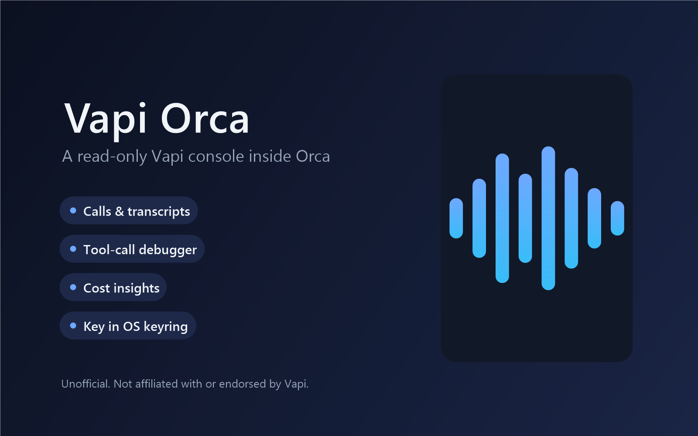

# Vapi Orca



**A read-only Vapi console inside the [Orca IDE](https://orca.dev).** Browse your assistants and
tools, read call transcripts, debug tool calls and see what your voice agents cost, right next to the
code you are building them with.

> **Unofficial.** Vapi Orca is a community plugin. It is not affiliated with or endorsed by Vapi.

## Features

| | |
|---|---|
| **Calls** | Filter by assistant and time range, with status, duration, cost, end reason and a masked caller number. Load older pages. |
| **Call detail** | Transcript, recording (opens in your browser), cost breakdown, and a redacted raw view. |
| **Tool-call debugger** | Every tool call in a call, its arguments, result and latency. A call with no result, or a result that looks like an error, is flagged as failed. Vapi has no logs API, so this view is built from the call itself. |
| **Insights** | Calls, cost, average duration and cost per call for 24 hours to 30 days; calls per day; cost by assistant; how calls ended; cost breakdown by LLM, STT, TTS and platform. |
| **Config** | Assistants, squads, tools and phone numbers with a collapsible JSON view. Secrets in configs are redacted. |
| **Network activity** | Every request the plugin made to Vapi: method, path, status and timing. |

## Security model

Vapi private API keys **cannot be restricted**: a private key can do anything in your Vapi
organization. So Vapi Orca is built to be safe to hand one:

- **Read-only by construction.** Every request passes one gate that allows only `GET` on a fixed
  list of read endpoints, plus `POST /analytics` (a read-only aggregation query). `PUT`, `PATCH` and
  `DELETE` are refused before a connection is made, and do not appear anywhere in the source.
- **One destination.** The worker talks only to `https://api.vapi.ai`. Redirects are refused,
  requests time out after 10 s and responses are capped at 4 MiB.
- **Key in the OS keyring.** The key is stored with Orca's encrypted secrets, protected by your
  operating system's keyring. The plugin refuses to store it if no keyring is available.
- **The panel never sees the key.** Only the plugin's worker reads it. The panel sees its last four
  characters (`…4a5b`).
- **Secrets in your configs are redacted.** Webhook secrets, auth headers, provider tokens, credential
  IDs and token-like URL parameters are replaced with `[redacted]` before anything reaches the panel.
- **Nothing on disk but the key.** Assistants, calls and transcripts are cached in memory for a
  minute and are gone when you disconnect or Orca stops.
- **No telemetry. No dependencies.** The plugin has no runtime dependencies and sends nothing to anyone
  but Vapi.

The full threat model, and how to check every claim above yourself, is in [SECURITY.md](SECURITY.md).

### What is sent where

| What | To | When |
|---|---|---|
| Your API key, in the `Authorization` header | `api.vapi.ai` | Every request |
| Read requests (`GET /assistant`, `/squad`, `/tool`, `/phone-number`, `/call`) | `api.vapi.ai` | When you open a view or press Refresh |
| Four fixed analytics queries (`POST /analytics`) | `api.vapi.ai` | When you open Insights |
| A recording link | Your web browser, after Orca asks you | When you press **Open recording** |
| The Vapi dashboard link | Your web browser, after Orca asks you | When you press **Open Vapi Dashboard** |

Nothing else leaves your machine.

### Permissions

Orca shows these before you install. Vapi Orca asks for exactly one capability:

| Capability | Why |
|---|---|
| `secrets:own` | To keep your Vapi API key in Orca's encrypted secret store. |

As a `trusted-worker` plugin, its worker runs as a normal Node.js process on your machine; Orca labels
it "Full access". That is why the worker is small, readable TypeScript with no dependencies, so you
can read exactly what it does. It uses no file-system, process or raw-socket APIs, and
`scripts/audit.mjs` checks that on every change.

## Install

Vapi Orca needs Orca **1.4.248 or newer**. It is tested on 1.4.272.

- **From the catalog**: open Orca's plugin catalog and search for **Vapi Orca**.
- **From GitHub**: `orca plugin install https://github.com/atherrehan/orca-vapi`

Orca shows the access it asks for and asks you to approve it.

## Connect

1. Open the **Vapi** panel (🤖) in Orca's right sidebar.
2. In the [Vapi Dashboard](https://dashboard.vapi.ai), open **Organization → API Keys** and copy a
   **private** key. If you can, use a dedicated or development organization.
3. Paste it and press **Connect**. Vapi Orca makes one read request to check the key and only stores
   it if Vapi accepts it.

**Disconnect** (twice, to confirm) removes the key from the keyring and clears everything in memory.
The command palette has **Vapi: Refresh**, **Vapi: Disconnect** and **Vapi: Show network activity**.

## Limits

- Assistants, squads, tools and phone numbers show the first 100 of each.
- Call lists only reach as far back as your Vapi plan keeps call history. Insights come from Vapi's
  analytics and can reach further.
- Tool-call failure detection is a heuristic: a missing result, or a result containing words such as
  "error", "failed" or "not found", or a 4xx/5xx status.
- Version 0.1 is read-only. Editing is not planned until it can be done with per-action confirmation.

## Troubleshooting

| Symptom | Fix |
|---|---|
| Panel stuck on "Loading…" | Run `orca plugin logs <plugin-key>`. If it says `took over the 2000 ms transpile budget`, Orca timed out converting one of the plugin's files on a busy machine and kept that failure. Restart Orca and open the panel again; if it persists, please [open an issue](https://github.com/atherrehan/orca-vapi/issues). |
| "That range goes past your Vapi plan's call-history retention" | Pick a shorter range. Your Vapi plan limits how far back calls can be listed. |
| "This machine has no OS keyring available to Orca" | On Linux, install and unlock a keyring (GNOME Keyring or KWallet). Vapi Orca will not store a key without one. |
| "Vapi rejected the API key (401)" | Use a **private** key, not a public one. |

## Development

You need Node 24 and Orca with its CLI on your `PATH`.

```sh
git clone https://github.com/atherrehan/orca-vapi
cd orca-vapi
npm ci                    # .npmrc sets ignore-scripts: no install scripts run
orca plugin types .       # Orca's typings, written to .orca/ (git-ignored)
npm run check             # security audit, typecheck, tests, manifest validation
orca plugin dev watch .   # load into Orca, hot reload, stream logs
```

There is no build step: Orca transpiles the TypeScript in `src/` when it loads it, so the code in
this repository is exactly the code that runs.

```
src/worker/   the only code that touches the key or the network (gate.ts, http.ts, keystore.ts, ...)
src/panel/    the UI: plain DOM TypeScript, no framework, text set with textContent only
src/shared/   types and the panel <-> worker contract
test/         node:test suites with Orca's mock host; fixtures hold only fake data
scripts/      audit.mjs: the static security audit
```

## Changelog

### 0.1.0 (unreleased)

- Connect and disconnect, with the key in the OS keyring.
- Calls, call detail and the tool-call debugger.
- Insights from Vapi analytics.
- Assistants, squads, tools and phone numbers with redacted configs.
- Network activity view and command palette commands.

## License

[MIT](LICENSE)
